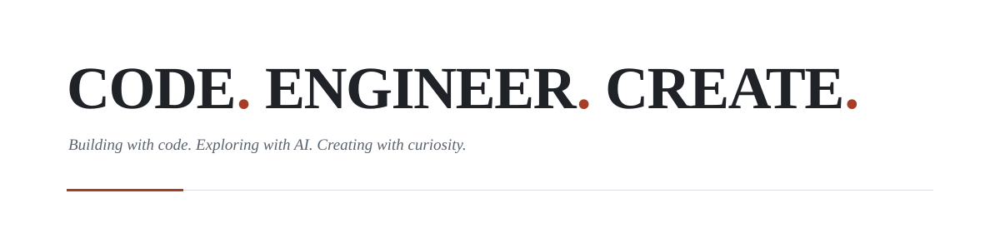

  <picture>
    <source media="(prefers-color-scheme: dark)" srcset="./assets/banner-dark.svg">
    <source media="(prefers-color-scheme: light)" srcset="./assets/banner-light.svg">
    
  </picture>

Software engineer working mostly in **Rust** and **Python**. I like problems that sit close to the machine — Windows APIs, Rust tooling, the bridge between backend types and the frontend — and ideas that are still rough enough to be interesting.

热爱代码与人工智能，享受从零开始探索技术、设计架构和构建软件的过程。

Currently exploring **LLMs, AI agents, and software architecture**, mostly by building small tools and learning in public.

## / work

| Project | What it does |
| :------ | :----------- |
| [**windows-notification**](https://github.com/jys17853678262/windows-notification) | Captures Windows toast notifications in real time through `UserNotificationListener` — multi-subscriber broadcast, filter rules, JSON Lines persistence and restart recovery. |
| [**auto_register_for_specta**](https://github.com/jys17853678262/auto_register_for_specta) | A small tool that scans a Rust workspace and auto-registers types with `specta`, taking the boilerplate out of Tauri type exports. |

## / stack

**Languages** 
    

**Tooling** 
    

**Exploring** 
  

## / activity

  <picture>
    <source media="(prefers-color-scheme: dark)" srcset="https://raw.githubusercontent.com/jys17853678262/jys17853678262/output/snake-dark.svg">
    <source media="(prefers-color-scheme: light)" srcset="https://raw.githubusercontent.com/jys17853678262/jys17853678262/output/snake.svg">
    
  </picture>

  

## / principles

> Great things are built, not imagined.
>
> 伟大的想法，值得被真正实现。

- **Stay curious.** Never stop exploring.
- **Think deeply.** Understand before building.
- **Build consistently.** Turn ideas into reality.
- **Share knowledge.** Grow through open source.

## / contact

Find me on [GitHub](https://github.com/jys17853678262), or open an issue on any repository if something there is useful to you. I'm always up for collaborating on Rust tooling, AI agents, and developer tools.

Think. Build. Explore.

